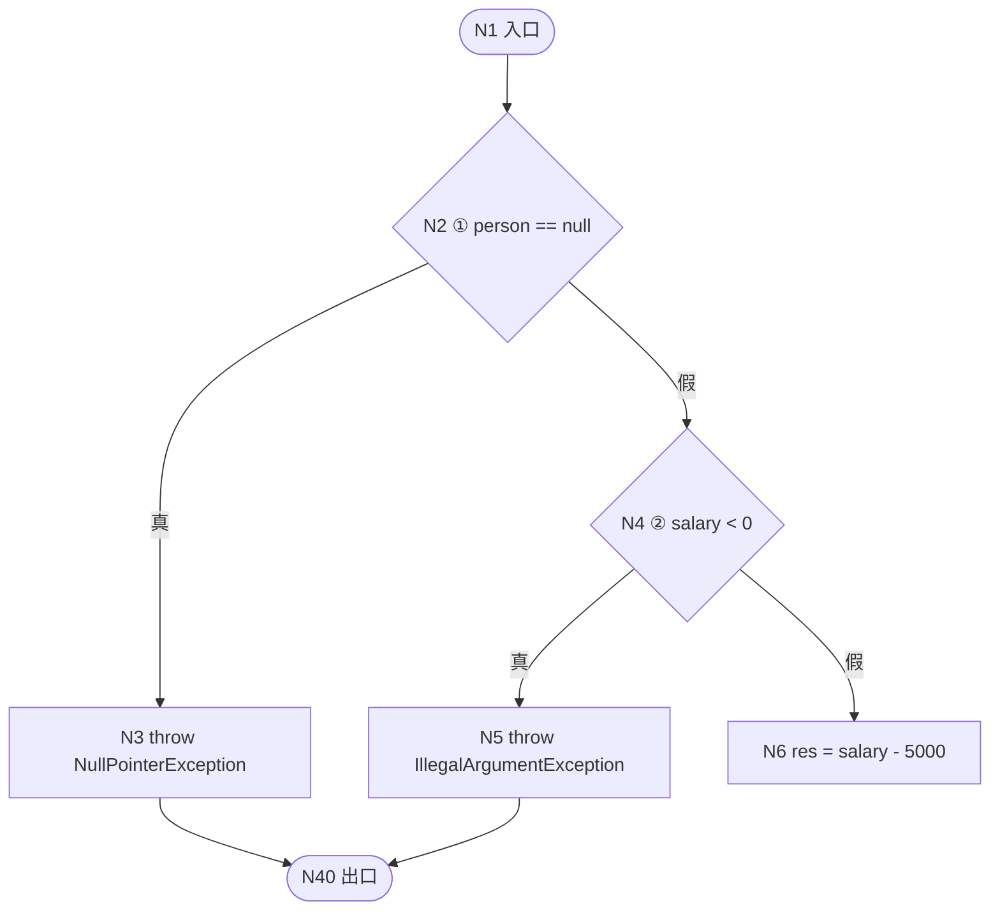
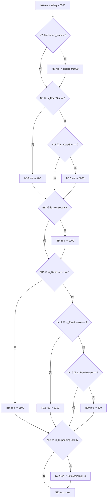
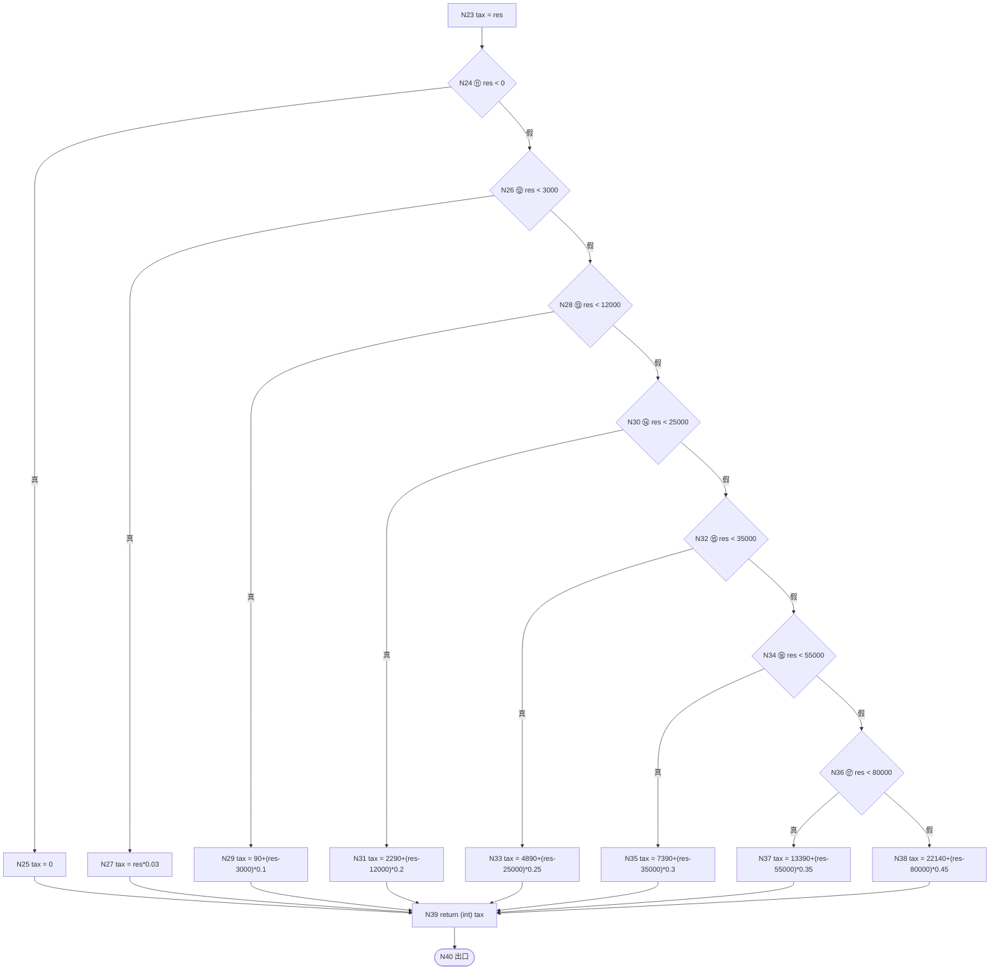

# 01 · 控制流图与圈复杂度分析

> 被测对象：`incomeTaxCalculator.cal(Person person, int salary)`
> 被测源码：`实验4/IncomeTaxCal.rtf`（原始 Java）→ 移植版 `src/tax_service/core/legacy.py`
> 分析日期：2026-11-01

---

## 1. 被测方法源码

```java
public static int cal(Person person, int salary) {
    //安全性检查
    if (person == null) {
        throw new NullPointerException("person为空");
    }
    if (salary < 0) {
        throw new IllegalArgumentException();
    }

    //应纳税所得额=月度收入-5000元（免征额）-专项扣除（三险一金等）-专项附加扣除-依法确定的其他扣除
    int res = salary - 5000;

    //专项附加扣除
    //子女教育:每个子女每月1000元
    if (person.getChildren_Num() > 0) {
        res -= person.getChildren_Num() * 1000;
    }

    //继续教育:在学历（学位）教育期间每月400元,在取得相关证书的当年，按照3600元定额扣除
    if (person.getIs_KeepStu() == 1) {
        res -= 400;
    } else if (person.getIs_KeepStu() == 2) {
        res -= 3600;
    }

    //住房贷款:在实际发生贷款利息的年度按每月1000元扣除
    if (person.is_HouseLoans()) {
        res -= 1000;
    }

    //住房租金: 1、直辖市、省会（首府）城市:每月1500元
    //         2、市辖区户籍人口超过100万的城市：每月1100元
    //         3、市辖区户籍人口不超过100万的城市：每月800元
    if (person.getIs_RentHouse() == 1) {
        res -= 1500;
    } else if (person.getIs_RentHouse() == 2) {
        res -= 1100;
    } else if (person.getIs_RentHouse() == 3) {
        res -= 800;
    }

    //赡养老人: 每个月扣除2000元/兄弟姐妹个数+1
    if (person.is_SupportingElderly()) {
        res -= 2000 / (person.getSibling_Num() + 1);
    }

    //计算个人所得税：个人所得税=应纳税所得额*税率
    double tax = res;
    //根据阶梯税率计算结果
    if (res < 0) {
        tax = 0;
    } else if (res < 3000) {          //0~3000元 税率3%
        tax = res * 0.03;
    } else if (res < 12000) {         //3000~12000元 税率10%
        tax = 90 + (res - 3000) * 0.1;
    } else if (res < 25000) {         //12000~25000元 税率20%
        tax = 2290 + (res - 12000) * 0.2;
    } else if (res < 35000) {         //25000~35000元 税率25%
        tax = 4890 + (res - 25000) * 0.25;
    } else if (res < 55000) {         //35000~55000元 税率30%
        tax = 7390 + (res - 35000) * 0.3;
    } else if (res < 80000) {         //55000~80000元 税率35%
        tax = 13390 + (res - 55000) * 0.35;
    } else {                          //大于80000部分税率40%
        tax = 22140 + (res - 80000) * 0.45;
    }

    return (int) tax; //返回结果取整
}
```

**结构特征**

| 特征 | 值 | 说明 |
|---|---|---|
| 分支结构 | 顺序 if / if-else if 链，无循环 | 控制流图是**有向无环图**（DAG） |
| 判定节点数 P | 17 | 见下表 |
| 圈复杂度 V(G) | **18** | 推导见第 4 节 |
| 独立路径数 | **18** | 等于 V(G) |

---

## 2. 语句编号表

为便于引用，把方法体划分为 40 个流图节点。

| 节点 | 语句 | 类型 |
|---|---|---|
| N1 | 函数入口 | 入口 |
| N2 | `if (person == null)` | 判定 ① |
| N3 | `throw new NullPointerException` | 终止语句 |
| N4 | `if (salary < 0)` | 判定 ② |
| N5 | `throw new IllegalArgumentException` | 终止语句 |
| N6 | `int res = salary - 5000;` | 处理 |
| N7 | `if (children_Num > 0)` | 判定 ③ |
| N8 | `res -= children_Num * 1000;` | 处理 |
| N9 | `if (is_KeepStu == 1)` | 判定 ④ |
| N10 | `res -= 400;` | 处理 |
| N11 | `else if (is_KeepStu == 2)` | 判定 ⑤ |
| N12 | `res -= 3600;` | 处理 |
| N13 | `if (is_HouseLoans())` | 判定 ⑥ |
| N14 | `res -= 1000;` | 处理 |
| N15 | `if (is_RentHouse == 1)` | 判定 ⑦ |
| N16 | `res -= 1500;` | 处理 |
| N17 | `else if (is_RentHouse == 2)` | 判定 ⑧ |
| N18 | `res -= 1100;` | 处理 |
| N19 | `else if (is_RentHouse == 3)` | 判定 ⑨ |
| N20 | `res -= 800;` | 处理 |
| N21 | `if (is_SupportingElderly())` | 判定 ⑩ |
| N22 | `res -= 2000 / (sibling_Num + 1);` | 处理 |
| N23 | `double tax = res;` | 处理 |
| N24 | `if (res < 0)` | 判定 ⑪ |
| N25 | `tax = 0;` | 处理 |
| N26 | `else if (res < 3000)` | 判定 ⑫ |
| N27 | `tax = res * 0.03;` | 处理 |
| N28 | `else if (res < 12000)` | 判定 ⑬ |
| N29 | `tax = 90 + (res - 3000) * 0.1;` | 处理 |
| N30 | `else if (res < 25000)` | 判定 ⑭ |
| N31 | `tax = 2290 + (res - 12000) * 0.2;` | 处理 |
| N32 | `else if (res < 35000)` | 判定 ⑮ |
| N33 | `tax = 4890 + (res - 25000) * 0.25;` | 处理 |
| N34 | `else if (res < 55000)` | 判定 ⑯ |
| N35 | `tax = 7390 + (res - 35000) * 0.3;` | 处理 |
| N36 | `else if (res < 80000)` | 判定 ⑰ |
| N37 | `tax = 13390 + (res - 55000) * 0.35;` | 处理 |
| N38 | `tax = 22140 + (res - 80000) * 0.45;` | 处理 |
| N39 | `return (int) tax;` | 出口语句 |
| N40 | 函数出口 | 出口 |

---

## 3. 控制流图

因节点较多，按功能分三段绘制；三段之间通过 N6 / N23 衔接，构成一张完整流图。

### 3.1 输入合法性守卫（N1–N6）



### 3.2 五类专项附加扣除（N6–N23）



### 3.3 阶梯税率（N23–N40）



---

## 4. 圈复杂度 V(G) 的三种算法互证

三种方法的**观测层面**不同：方法一数语法上的判定节点，方法二数图论上的边与点，方法三数平面被切开的区域。

> **诚实说明**：方法二与方法三在数学上同源——平面连通图的区域数由欧拉公式 `R = E − N + 2` 给出，与方法二完全同式，因此二者**不能互为独立验证**。它们与方法一的关系是：对只有二值判定的结构化流图，恒有 `E = N − 1 + P`，代入即得 `E − N + 2 = P + 1`。三者一致是**结构性必然**，而非巧合。
>
> 真正独立的验证来自：① 手工逐条数判定节点（方法一）；② `tests/unit/test_control_flow_metrics.py` 用 AST 解析源码自动计数，与文档比对。若手工画流图时漏画或多画了分支，方法一与方法二会同时出错而无法互查——所以自动化校验是必要的补充。

### 方法一：判定节点法

> **V(G) = P + 1**，P 为判定节点数。

| # | 判定节点 | 条件 |
|---|---|---|
| ① | N2 | `person == null` |
| ② | N4 | `salary < 0` |
| ③ | N7 | `children_Num > 0` |
| ④ | N9 | `is_KeepStu == 1` |
| ⑤ | N11 | `is_KeepStu == 2` |
| ⑥ | N13 | `is_HouseLoans()` |
| ⑦ | N15 | `is_RentHouse == 1` |
| ⑧ | N17 | `is_RentHouse == 2` |
| ⑨ | N19 | `is_RentHouse == 3` |
| ⑩ | N21 | `is_SupportingElderly()` |
| ⑪ | N24 | `res < 0` |
| ⑫ | N26 | `res < 3000` |
| ⑬ | N28 | `res < 12000` |
| ⑭ | N30 | `res < 25000` |
| ⑮ | N32 | `res < 35000` |
| ⑯ | N34 | `res < 55000` |
| ⑰ | N36 | `res < 80000` |

**P = 17，故 V(G) = 17 + 1 = 18。**

> 注：`else` 分支不是判定节点，不单独计数；`if / else if` 链中每个条件各算一个判定节点。

### 方法二：边点法（Euler 公式）

> **V(G) = E − N + 2**

统计流图节点与边：

| 项目 | 数量 |
|---|---|
| 节点 N | 40（N1–N40） |
| 边 E | 56 |

**V(G) = 56 − 40 + 2 = 18。**

边明细（供核对）：

| 边 | 连接 | 边 | 连接 | 边 | 连接 | 边 | 连接 |
|---|---|---|---|---|---|---|---|
| E1 | N1→N2 | E15 | N11→N12 | E29 | N20→N21 | E43 | N30→N31 |
| E2 | N2→N3 | E16 | N11→N13 | E30 | N21→N22 | E44 | N30→N32 |
| E3 | N2→N4 | E17 | N12→N13 | E31 | N21→N23 | E45 | N31→N39 |
| E4 | N3→N40 | E18 | N13→N14 | E32 | N22→N23 | E46 | N32→N33 |
| E5 | N4→N5 | E19 | N13→N15 | E33 | N23→N24 | E47 | N32→N34 |
| E6 | N4→N6 | E20 | N14→N15 | E34 | N24→N25 | E48 | N33→N39 |
| E7 | N5→N40 | E21 | N15→N16 | E35 | N24→N26 | E49 | N34→N35 |
| E8 | N6→N7 | E22 | N15→N17 | E36 | N25→N39 | E50 | N34→N36 |
| E9 | N7→N8 | E23 | N16→N21 | E37 | N26→N27 | E51 | N35→N39 |
| E10 | N7→N9 | E24 | N17→N18 | E38 | N26→N28 | E52 | N36→N37 |
| E11 | N8→N9 | E25 | N17→N19 | E39 | N27→N39 | E53 | N36→N38 |
| E12 | N9→N10 | E26 | N18→N21 | E40 | N28→N29 | E54 | N37→N39 |
| E13 | N9→N11 | E27 | N19→N20 | E41 | N28→N30 | E55 | N38→N39 |
| E14 | N10→N13 | E28 | N19→N21 | E42 | N29→N39 | E56 | N39→N40 |

### 方法三：平面区域法

> **V(G) = 平面流图划分出的区域数 R（含图外无限区域）**

该流图不含循环、不含交叉边，是**连通平面图**，可用欧拉公式 `R = E − N + 2` 求区域数：

**R = 56 − 40 + 2 = 18。**

区域数的直观含义：每个判定节点都会把平面「切开」一块新区域，17 个判定节点把平面切成 17 个内部区域 + 1 个外部区域 = 18 个区域。

### 三种方法结论汇总

| 方法 | 观测层面 | 公式 | 计算 | 结果 |
|---|---|---|---|---|
| 判定节点法 | 语法 | V(G) = P + 1 | 17 + 1 | **18** |
| 边点法 | 图论 | V(G) = E − N + 2 | 56 − 40 + 2 | **18** |
| 平面区域法 | 几何 | V(G) = R | 56 − 40 + 2 | **18** |

三者一致，**V(G) = 18**，即需要 **18 条独立路径**才能覆盖全部可执行语句，测试用例数量的理论下界为 18。

> 自动化校验：`tests/unit/test_control_flow_metrics.py::TestSutComplexityMatchesDocumentation` 用 AST 独立数出 P = 17、V(G) = 18，与本节手工结论一致。该测试已通过。

---

## 5. 复杂度解读

| 指标 | 值 | 工程含义 |
|---|---|---|
| 圈复杂度 | 18 | 高于业界常用的 10 上限，属**高复杂度方法**，维护与测试成本高 |
| 独立路径数 | 18 | 纯白盒测试的最低用例数 |
| 判定节点占比 | 17 / 40 = 42.5% | 近一半节点是判定，说明逻辑以分支为主 |
| 最高复杂度来源 | 税率阶梯（判定 ⑪–⑰，7 个） | 占全部判定节点的 41% |

**可测试性改进建议**（作为测试方对开发方的反馈）：

1. **税率阶梯数据化**：把 7 个硬编码分支改为税率表遍历，可把该段的判定节点从 7 个降到 3 个，同时消除「抄错常量」类缺陷——本项目缺陷 D1 正是这样产生的。
2. **输入校验集中化**：判定 ①–② 与判定 ③–⑩ 中的枚举取值校验应抽成独立的参数校验层，使主流程复杂度下降且校验规则可单测。
3. **拆分方法**：`cal` 同时承担「输入校验 + 专项扣除累加 + 税率计算」三项职责，建议拆为三个方法。

### 重构收益实测

上述三条建议已在 `src/tax_service/core/oracle.py` 中实现（表驱动 + 集中校验 + 职责拆分），与 SUT 形成对照。用 AST 静态分析实测（`tests/unit/test_control_flow_metrics.py`）：

| 指标 | SUT `IncomeTaxCalculator.cal` | Oracle | 变化 |
|---|---|---|---|
| 单方法最高圈复杂度 | **18** | **9**（`validate`） | −50% |
| 超过阈值 10 的方法数 | 1 | **0** | 全部达标 |
| 税率阶梯段判定节点数 | 7 | 3 | −57% |
| 方法数 | 1 | 4 | 职责拆分 |

| Oracle 方法 | 圈复杂度 |
|---|---|
| `validate` | 9 |
| `taxable_income` | 6 |
| `cal` | 5 |
| `elderly_share` | 2 |

> 复杂度最高的是 `validate`（9）——这是**有意接受的取舍**：把分散在业务逻辑里的 8 个校验判定集中到一处，虽让 `validate` 成为最复杂的单方法，但使业务计算方法的复杂度大幅下降，且校验规则可独立测试。该取舍已由 `test_validate_has_the_highest_complexity` 守住。

> **注意**：上表比较的是**单方法**复杂度，不是模块总复杂度。Oracle 的模块总复杂度高于 SUT（拆分本身会增加方法间的调用分支），但单方法复杂度全部回到可控区间——这正是「高内聚、低耦合」在度量上的体现。

---

## 6. 下一步

- 独立路径的推导过程见 [02-独立路径分析](02-独立路径分析.md)
- 白盒用例表与执行结果见 [03-白盒测试用例](03-白盒测试用例.md)
- 缺陷清单见 [05-缺陷分析报告](05-缺陷分析报告.md)
